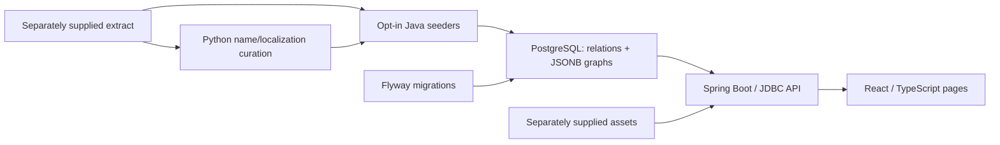

# LumenTale Wiki

A full-stack fan wiki for **LumenTale: Memories of Trey**, connecting creatures, moves, quests, story scenes and world-map locations in a searchable web interface. Built with **Java 17 / Spring Boot, React / TypeScript and PostgreSQL**.

> **Personal, non-commercial fan project**, unaffiliated with the game's developers or publishers. All game content, names and artwork belong to their respective owners. This repository distributes the **application code only**, under the [MIT license](LICENSE). Game-derived data and artwork are not included or licensed by this repository.

## What the app supports

- Creature variants with stats, elemental/emotion matchups, learnsets, evolution chains and spawn locations.
- Navigable world maps with linked exits, pickups, spawns and encounters; marker placement uses map coordinates and optional per-tile calibration.
- Story dialogue and quest-flow browsing, boss battle graphs, and links between related entities.
- Moves, items, crafting, cards, furniture, trainers, camps, squadrons, achievements, tutorials and mechanics pages.
- Localization lookup with English defaults, supplied by a separately staged dataset.

These capabilities depend on compatible game data. The default configuration disables seeding and is intended for schema-only startup; a fresh clone does not provide a populated wiki or game artwork. No screenshot set or hosted demo is included here.

## Engineering overview



- **Data modeling:** UUID-keyed entities and foreign keys represent relationships; whole story/battle graphs use JSONB documents with relational rollups for cross-links. See the [migrations](wiki-db/migrations).
- **Backend:** domain packages separate controllers, services and JDBC repositories. Seeders import staged JSON; shared helpers resolve localization, references and asset URLs.
- **Frontend:** typed React pages combine API data with map overlays, dialogue readers and graph views. Shared components handle loading, errors, empty states and missing images.
- **Data tooling:** Python resolves localized names and cross-references. Map calibration fits marker placement to existing tile images. The raw extractor and GPU map renderer are outside this checkout.
- **Performance choices:** startup indexes, HTTP/asset caching, JSON compression, frontend response caching and in-flight request reuse suit a read-mostly dataset. These are implementation choices, not benchmark results.

See the [engineering source tour](docs/ENGINEERING.md) for code links, tradeoffs, test scope and a reusable project summary.

## Run locally

Prerequisites: Java 17, Docker Compose for PostgreSQL 16, and Node.js 20.19+ in the 20.x line or 22.12+ (the locked Vite requirement). The examples use Bash, with each terminal starting at the repository root.

```bash
# Terminal 1: database (local development credentials only)
docker compose up -d

# Terminal 2: API on http://localhost:8084
cd backend
./gradlew bootRun

# Terminal 3: UI on http://localhost:5177
cd frontend
npm ci
npm run dev
```

On Windows, use `gradlew.bat bootRun` in the backend terminal. Gradle sets the JVM working directory to the repository root so migrations and data paths resolve correctly. The Vite development server proxies `/api` and `/data` to the backend. The Compose database is `anidex4` on port `5433` with matching local-only username/password.

With the API running, inspect `http://localhost:8084/` for its endpoint index and `/api/meta` for entity counts. Setup commands are matched to source configuration; runtime success was not reproduced during this documentation review.

## Data: separately supplied, never redistributed here

The dataset is withheld out of respect for the game creators' IP. Owning the game does not grant permission through this repository to redistribute extracts or imagery. Only use data and assets you are authorized to obtain and use.

A compatible local dataset follows this layout:

```text
data/
  seed/       extraction JSON and loc/ localization files
  curated/    output from tools/build_curated_data.py
  assets/     optional exported images, e.g. maps/<guid>/tile.png
```

With compatible inputs staged, `python3 tools/build_curated_data.py` generates curated names and cross-references. Enable importing empty tables explicitly:

```bash
# From backend/, with the database running
LUMENTALE_SEED_ON_EMPTY=true ./gradlew bootRun
```

Optional mechanics, logic-graph and manifest inputs use `LUMENTALE_PHASE4_DIR` (default `phase4-complete` relative to the repository root). Missing sources limit the corresponding features. These tools consume pre-existing extracts; the repository does not provide a raw game-extraction or map-rendering pipeline. See [configuration](backend/src/main/resources/application.properties).

## Build and verification

```bash
# Run from repository root in Bash
(cd backend && ./gradlew test)
(cd frontend && npm ci && npm run build)
```

The backend contains unit tests for graph assembly, quest flow, type calculations and other domain logic. These do not establish that a full dataset imports or that every page works. No fresh test pass or rendering-speed measurement is claimed by this README.

`./build.sh` builds the frontend and backend jar; its default backend path skips tests. `./run.sh` builds missing artifacts and starts the API plus Vite preview on port 4173; start PostgreSQL separately. Run Gradle tests explicitly as above.

## Container packaging

The [Dockerfile](Dockerfile) builds the SPA into the Spring Boot jar and includes the migrations, without game data. Configure an external database for the container:

```bash
docker build -t lumentale-wiki .
docker run --rm -p 8080:8080 \
  -e SPRING_DATASOURCE_URL=jdbc:postgresql://<host>:<port>/<db> \
  -e SPRING_DATASOURCE_USERNAME=<user> \
  -e SPRING_DATASOURCE_PASSWORD=<password> \
  lumentale-wiki
```

Use a database hostname reachable from the container. To supply authorized local data, add `-v /absolute/path/to/data:/app/data:ro` and `-e LUMENTALE_SEED_ON_EMPTY=true`; configure and mount optional phase-four inputs separately if needed. This describes the packaging in source, not a verified deployment.

## Documentation

- [Engineering source tour and project summary](docs/ENGINEERING.md)
- [Backend setup and tests](backend/README.md)
- [Frontend setup and structure](frontend/README.md)
- [Historical backend design](backend/ARCHITECTURE.md) and [database design](wiki-db/00-OVERVIEW.md)

Historical notes retain earlier version names, counts and validation reports; use current configuration and migrations for setup and scope.
